# BME 6120 — Quantitative tumor modeling

**English** | [繁體中文](README.zh-TW.md)

A stochastic, discrete-generation branching model of a tumor under therapy. Each cell either dies or divides into two or three daughters; daughters can mutate irreversibly. The project simulates 30 tumors, then checks the simulation against branching-process theory that uses the same single-cell rule and no fitted parameters.

**Main claim: therapy does not create resistance; it selects resistance that is already there.**

All parameters are teaching assumptions, not clinical estimates.

> **Start here: [`presentation/tumor_branching_model.pdf`](presentation/tumor_branching_model.pdf)** is the final report. It is the same content and layout as the web page [`presentation/web/index.html`](presentation/web/index.html), which opens offline in any browser.

## Folder layout

```
presentation/                  what to read or present
  tumor_branching_model.pdf    ★ final report (same as the web page)
  web/                         the web page: index.html + figures, fonts, KaTeX
  slides/                      older Traditional Chinese teaching decks (.pptx)
  archive/                     older discussion cue sheets and documents
code/                          all source code
  simulation.py                the model itself
  experiments.py               repeated trials, controls, data I/O
  analysis.py                  theory formulas and derived statistics
  plot_*.py                    figures, one file per topic
  main.py                      entry point
  paths.py                     where outputs are written
  test_simulation.py           unit tests
  presentation_build/          scripts that built the older decks and cue sheets
output/
  plots/                       every figure (PNG 240–300 dpi + SVG)
  data/                        every number behind the figures (CSV, JSON)
```

`output/plots/` and `output/data/` mirror each other: a figure in `output/plots/therapy_analysis/` has its data in `output/data/therapy_analysis/`.

## Run it

```bash
python3 -m venv .venv
.venv/bin/python -m pip install -r requirements.txt

.venv/bin/python code/main.py                     # every step (about 3 minutes on 12 cores)
.venv/bin/python code/main.py --only results      # main and control experiments only
.venv/bin/python code/main.py --only therapy --analyses goldie_coldman
.venv/bin/python -m unittest discover -s code -p 'test_*.py'
```

Steps run in order: `results`, `model`, `phase`, `genotype`, `therapy`. Later steps read the CSVs written by `results`, so run `results` first on a fresh checkout. `--seed` and `--replicates` (default 30) change the stochastic experiments. Use the project's `.venv`; nothing is installed into conda.

Every run is reproducible: each trial has its own fixed seed, and later steps rerun the recorded seeds and check the result against the saved CSV before using it.

## The model

| Rule | Value | Why |
| --- | --- | --- |
| Start | 100 unmutated cells | Small enough that early resistant mutations are rare |
| Genes | 3 oncogenes, 1 resistance gene, 2 tumor suppressors (two alleles each), 14 neutral passengers | Passengers are a neutral control for the functional genes |
| One generation | each cell dies with probability d, otherwise makes 3 daughters with probability q, else 2 | The simplest law with growth and a real chance of extinction |
| Defaults | d = 0.30, q = 0.04 → mean offspring m = (1−d)(2+q) = 1.428 | Supercritical (m > 1), so tumors grow but single lineages often die |
| Drivers | an active oncogene or a lost TSG lowers d and raises q | Each class counts once; the two classes add |
| Mutation | each unmutated bit of each daughter flips with μ = 0.001, irreversibly | Inflated from realistic rates so effects appear within ~30 generations |
| Therapy | starts the first generation the tumor reaches 20,000 cells and stays on; extra kill k = 0.90 for sensitive, 0.04 for resistant cells | Kill acts on natural survivors: total death = 1 − (1−d)(1−k) |
| Stop | extinction, 10⁶ cells, or generation 75 | 10⁶ is a computing cap, not a carrying capacity |

**How it is implemented, and why.**
- A tumor is a dictionary `{genotype: cell count}`, where the genotype is a 22-bit integer (20 genes plus a second allele bit for each TSG). Cells with the same genotype have the same fate probabilities, so a whole genotype is updated with two binomial draws (survivors, then triple divisions). This has exactly the same distribution as flipping a coin for every cell and is far faster.
- Mutation is a bitwise OR on the genotype. It only moves cells between dictionary entries, so the total is conserved (unit-tested).
- Order within a generation: therapy kill → survival and division → mutation of the daughters. A new mutation therefore takes effect from the next generation, and therapy never changes μ: resistance can only arise beforehand, by chance.
- A genotype is not a lineage: the same genotype can arise independently more than once.

The model leaves out space, immunity, resource competition and quiescent cells.

## Results

Numbers are from the default run (30 trials per group unless stated).

### 1. Resistance is already there when therapy starts (Fig. 01, Muller plot)

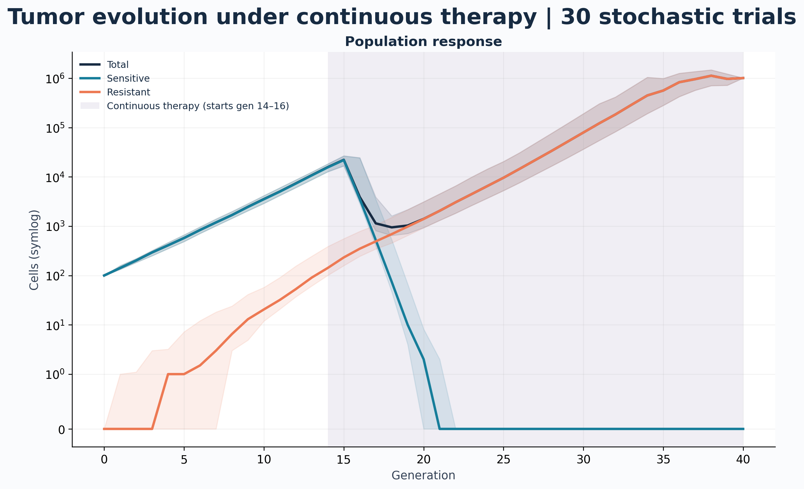

- Therapy starts at generation 14–16 (median 15), when each tumor first reaches 20,000 cells.
- In **30 of 30 trials resistant cells were already present at therapy start** (median 1.2% of the tumor).
- On therapy, sensitive cells have mean offspring 0.143 and vanish within about six generations; resistant cells keep growing at ×1.371 per generation. The tumor shrinks to a median minimum of 814 cells, then grows back: **30 of 30 trials relapsed**, a median 13 generations (range 9–16) after therapy started.
- The Muller plot (`output/plots/genotype_evolution/muller_top_genotypes_en.png`) shows who takes over: resistant genotypes that also carry an oncogene. Every trial ends the same way, but with different genotypes each time.

*Relapse* means the burden first falls below the burden at therapy start and later returns to it. No relapse within the window is recorded separately and is not called a cure.

### 2. One-hit vs two-hit tumor suppressors (Fig. 03)

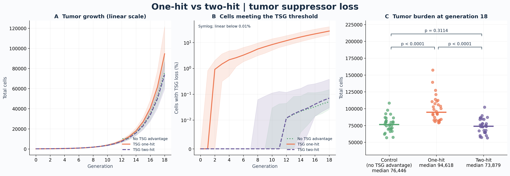

Untreated growth for 18 generations, three groups of 30 that differ only in the TSG rule: a control in which TSG loss gives no advantage, one-hit (either allele is enough) and two-hit (both alleles of the same gene).

| Group | Cells past the TSG threshold at gen. 18 | Median burden at gen. 18 |
| --- | --- | --- |
| Control | 0.05% | 76,446 |
| One-hit | 27.9% | 94,618 |
| Two-hit | 0.07% | 73,879 |

Pairwise permutation tests of the medians: control vs one-hit p < 0.0001, one-hit vs two-hit p < 0.0001, control vs two-hit p = 0.31.

**Why:** a recessive suppressor gives no advantage after the first hit; that hit only drifts. The advantage needs the second allele of the same gene, roughly μ² per cell, so within 18 generations two-hit tumors cannot be told apart from the control. This means "no difference yet within 18 generations", not "two-hit has no effect".

### 3. Higher death rate → more diversity at the same size (Fig. 02)

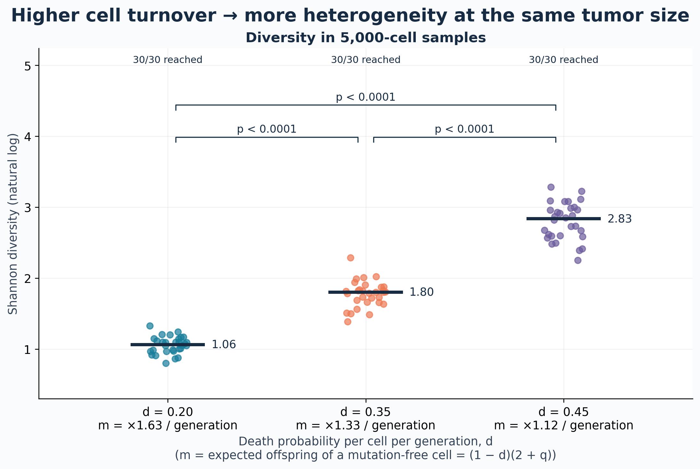

Each trial is sampled once, 5,000 cells without replacement, in the first generation it crosses 5,000 cells.

| Death rate d | Net growth m | Generations to 5,000 cells (median) | Shannon diversity (median) |
| --- | --- | --- | --- |
| 0.20 | ×1.63 | 8 | 1.06 |
| 0.35 | ×1.33 | 14 | 1.80 |
| 0.45 | ×1.12 | 26.5 | 2.83 |

All three pairs differ, p < 0.0001. **Why:** with more cell death, a tumor needs more generations and more divisions to reach the same size, so it accumulates more mutations. Tumor size alone does not tell you its history.

### 4. Theory without fitted parameters predicts cure (Fig. 08, Goldie–Coldman)

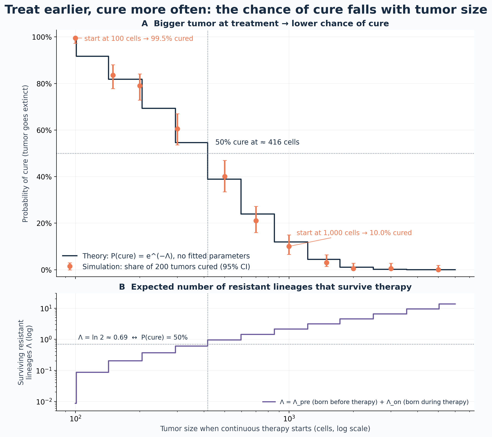

Continuous therapy was started at 11 tumor sizes from 100 to 5,000 cells, 200 trials each. Cure means the tumor goes extinct.

| Therapy start (cells) | Simulated cure | Theoretical cure | Surviving resistant lineages Λ |
| --- | --- | --- | --- |
| 100 | 99.5% | 99.1% | 0.009 |
| 300 | 60.5% | 54.6% | 0.61 |
| 500 | 40.0% | 38.8% | 0.95 |
| 1,000 | 10.0% | 11.9% | 2.1 |
| 2,000 | 0.5% | 1.1% | 4.5 |
| 5,000 | 0% | ≈ 0% | 9.5 |

**How the theory works.** Cure means not one resistant lineage survives therapy. Resistant mutants arise as a Poisson process from the growing sensitive population; a clone born i generations before therapy has grown for T − i generations and survives with probability 1 − f^(T−i)(q_on), where q_on = 0.479 is the chance that one resistant lineage dies out on therapy. Adding these gives Λ, the expected number of surviving resistant lineages, and P(cure) = e^(−Λ). The theory crosses 50% cure at about **416 cells** (Λ = ln 2) and matches the simulation at every size.

**Why it works:** three assumptions make the lineage count the deciding quantity: mutation is irreversible, lineages evolve independently, and mutational origins are rare and independent. The extinction probability is found by iterating s ← f(s) from 0 rather than solving the polynomial, so the same code still works if the model later allows more than three daughters.

### 5. Expected flow in burden × resistant-fraction coordinates (phase plot 05)

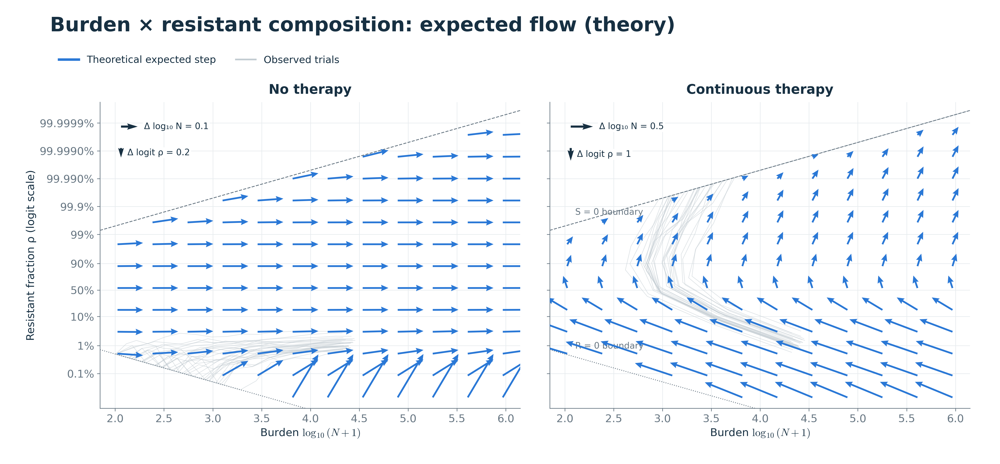

`output/plots/phase_plots/phase_field_burden_logit_en.png` draws the theoretical one-step expected change at every point of (tumor size, logit of the resistant fraction), with the 30 actual trajectories in grey. Without therapy the resistant fraction stays nearly constant (resistance is neutral). On therapy the logit rises about one decade per generation (log₁₀(1.371/0.143) = 0.98), so every trajectory makes the same C-shaped turn: burden falls while resistance takes over, then an almost fully resistant tumor grows back.

### Other analyses kept in the outputs

These are not in the final report but their figures and data are in `output/`:

**Relapse-time prediction** (`therapy_analysis/relapse_time_prediction`): from the genotypes at therapy start alone, letting each resistant genotype grow at its own rate predicts the exact relapse generation in 24/30 trials (mean error 0.2 generations, vs 2.0 for a single growth rate).

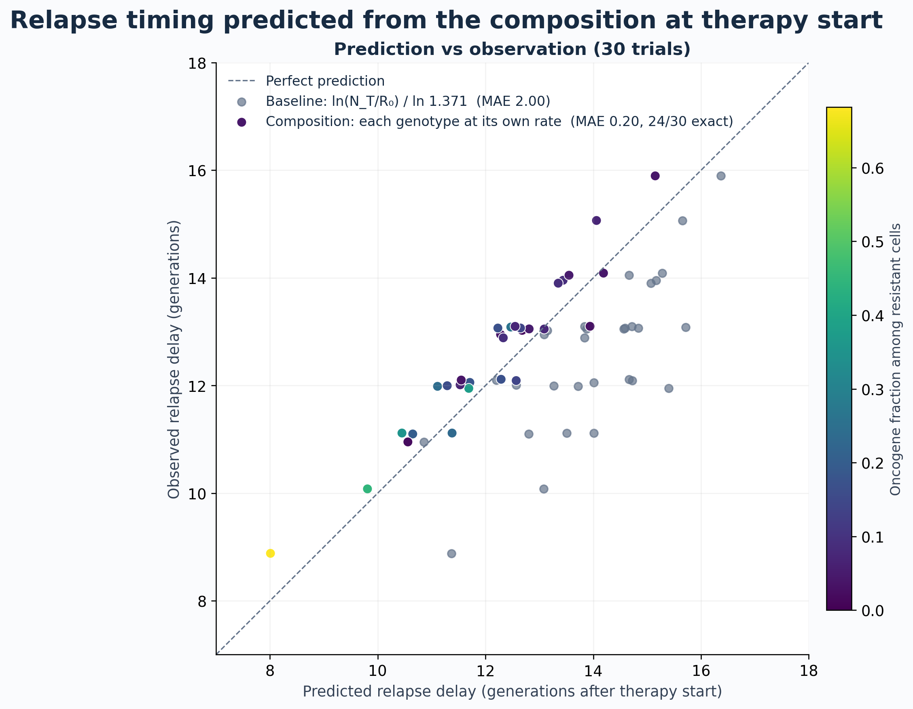

**Parameter sensitivity** (`therapy_analysis/parameter_sensitivity`): plain resistant cells stop growing at k_R = 0.30, but cure needs about 0.41, where oncogene-carrying resistant cells also stop growing; higher μ makes such cells more likely to pre-exist.

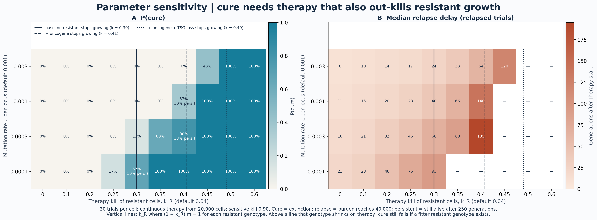

**Adaptive therapy** (`therapy_analysis/adaptive_therapy`): without competition, pausing therapy only helps resistant cells (time to progression 11 vs 13 generations). With carrying-capacity competition (K = 30,000), adaptive therapy delays progression (16 vs 14 generations, longer in 30/30 paired trials) with drug on about 44% of the time.

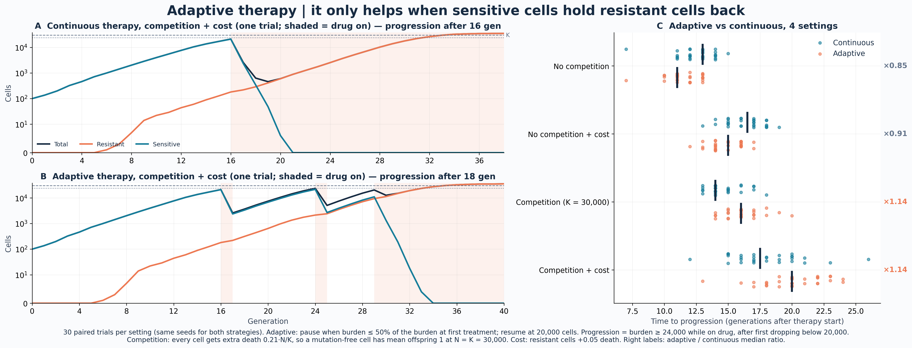

**Gene frequencies**

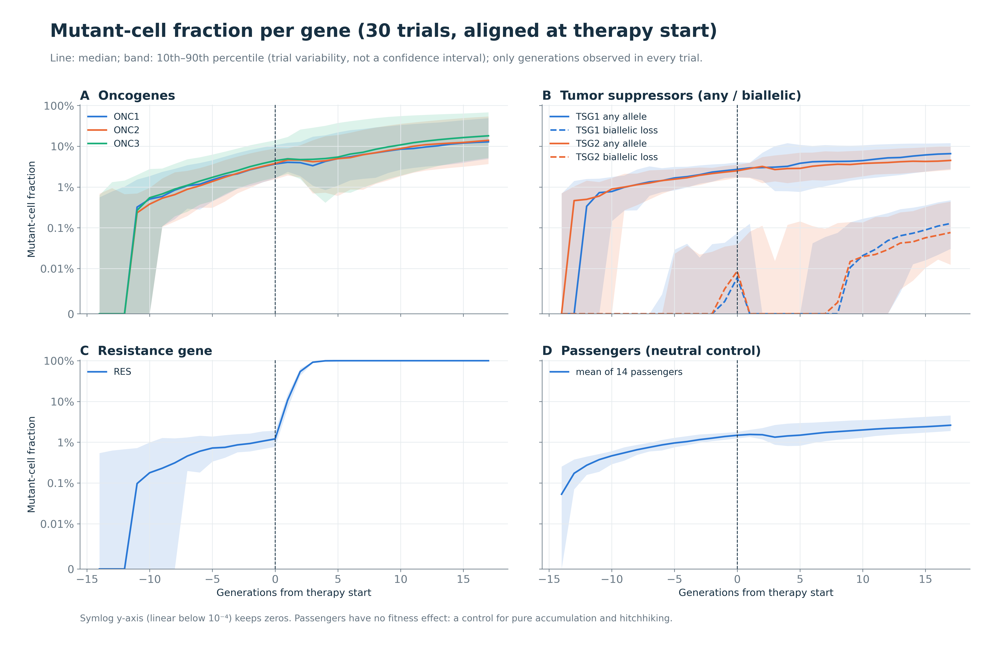

**S–R phase portrait**

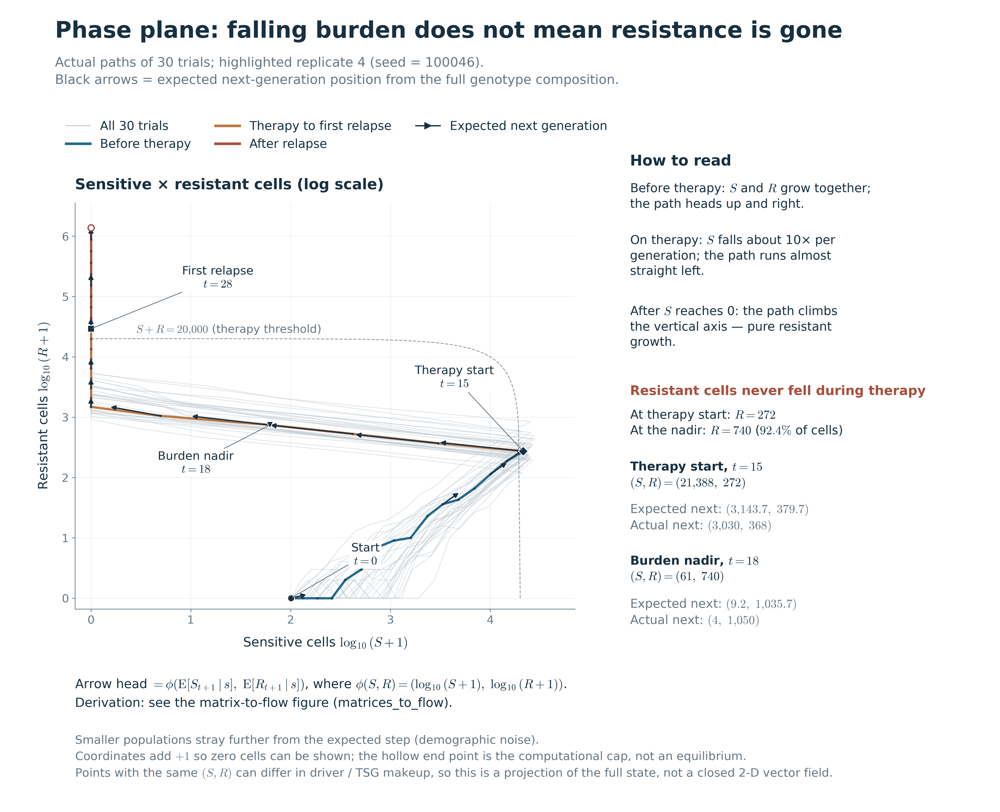

**Fitness × resistant-fraction field**

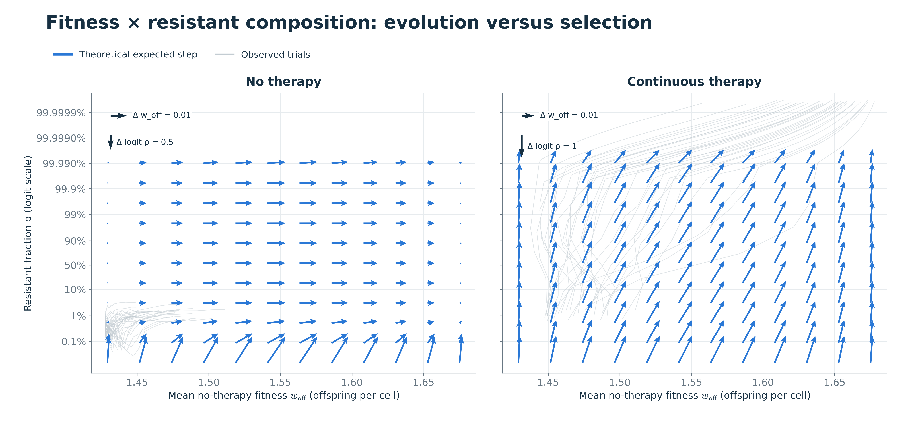

**Matrix-to-flow figure**

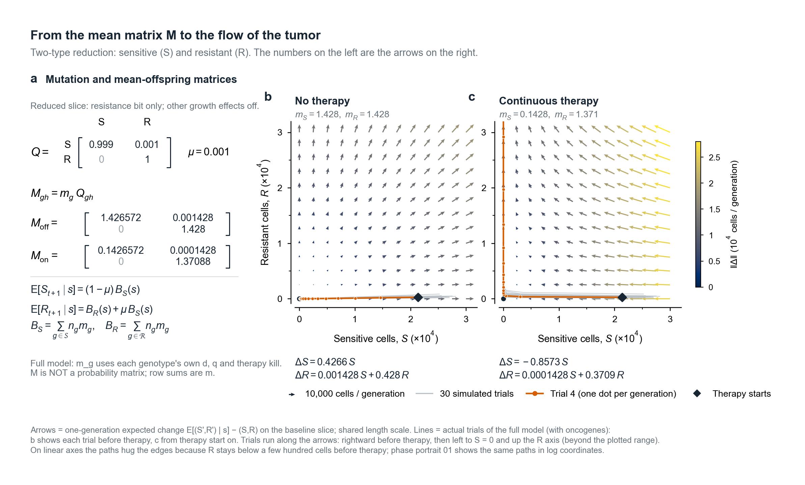

## Methods choices, and why

- **Report trial variation, not confidence intervals.** Bands are 10th–90th percentiles across trials. More trials stabilize the summary but do not remove biological randomness.
- **Permutation tests on medians.** Burdens and diversities are skewed, and the figures show medians, so the test compares medians directly (two-sided, 20,000 shuffles, implemented with NumPy).
- **Keep every trial.** Trials that go extinct stay as zeros; after the 10⁶-cell cap later values are missing, never padded; trials that miss a target size stay in the CSV. No seeds were chosen to look good.
- **Fixed-size samples for diversity.** Comparing tumors at one size needs equal-size samples, otherwise faster tumors that overshoot the threshold look different just because they are bigger.
- **Theory as an independent check.** The theory reuses the single-cell rule but none of the simulated data. Agreement checks both the code and the reasoning; disagreement points to randomness or to genotype detail the theory leaves out.
- **Separate seed blocks** for each experiment, so changing one experiment never changes another.

## Code notes

- `simulation.py` is the place to start reading: `Config` → genotype and phenotype → `growth_probabilities` → `mutate_offspring` → `simulate` → `therapy_outcome`.
- Comments and docstrings are written in Chinese with an English version next to each.
- `experiments.py` returns plain data and the `plot_*` modules only draw, so either side can be reused on its own.
- Formatting uses black (`pyproject.toml`). Phase and genotype figures are produced in English (`_en`) and Traditional Chinese (`_zh`).
- `code/presentation_build/` holds the scripts behind the older decks and cue sheets in `presentation/slides/` and `presentation/archive/`. They select code excerpts by line number and refer to removed features (IL11), so they need updating before reuse.

Use the model from Python:

```python
from simulation import Config, simulate   # run from inside code/

result = simulate(Config(suppressor_hits=1, mutation_rate=0.0005), seed=7)
print(result.history[-1]["total"])
```
